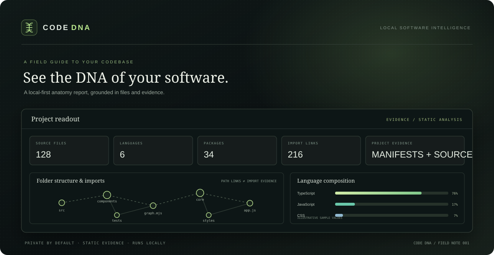
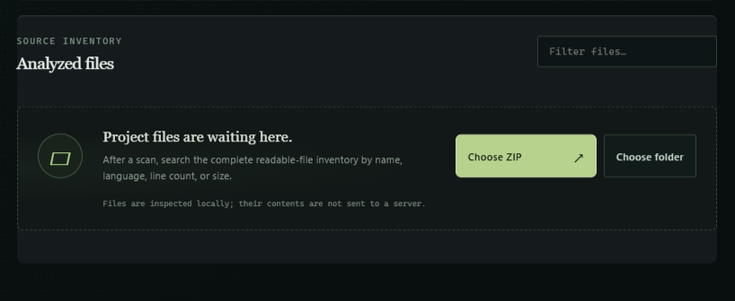

# CODE DNA     

> **See the DNA of your software.**



*Cover artwork is an illustrative product mockup; its sample metrics are not analysis results.*

CODE DNA is a local-first project explorer that turns a codebase into an evidence-backed software anatomy report. It inventories readable files, summarizes languages and package manifests, and maps folders alongside statically detected local imports.

**Project status:** early prototype. ZIP and local file analysis, Software Anatomy, and the DNA Map are implemented. Broader architecture intelligence described in the long-term vision is still on the roadmap; see [feature status](./docs/FEATURES.md).

## What you can explore

- **Overview** — source-file, language, dependency, and local-import counts, with a language distribution and detected technology list.
- **Software Anatomy** — language share, evidence-backed technology detections, declared package scripts, project folders, direct manifest dependencies, configuration files, and transparent analysis limits.
- **DNA Map** — a searchable folder/file graph with distinct path-containment and statically resolved import links, zoom controls, and per-file or folder evidence.
- **File inventory** — readable project files with language, size, line count, and large-file scan status.
- **Large local files** — folder and file selection can stream text files up to the configured limits. The report retains metadata rather than full contents for streamed files.
- **Private by default** — source files are analyzed in your browser. The local Node server serves the app and does not receive project uploads.

All findings are labeled according to their evidence. CODE DNA does not execute project code or claim to observe runtime behavior.

## Interface glimpse

The Source Inventory keeps its empty state actionable and shows where analyzed files will appear.



## Run locally

**Requirements:** Node.js 20 or newer, plus a current browser with `DecompressionStream` support for ZIP extraction.

```sh
git clone <repository-url>
cd codedna
npm start
```

Open [http://127.0.0.1:4173](http://127.0.0.1:4173). No package installation or build step is required.

To run the automated analyzer checks:

```sh
npm test
```

## Use it

1. Choose a ZIP archive, a project folder, or individual files. You can also drag files, folders, or a ZIP onto the app.
2. Watch the local scan progress and review the completion notice.
3. Browse **Overview** for a summary, **Anatomy** for evidence and details, or **DNA Map** for file structure and detected imports.
4. Search the DNA Map or inventory to narrow a large project.

### Input limits and file handling

| Input | Current limits |
| --- | --- |
| Folder or individual files | Up to 1 GB per file, 1 GB total, and 25,000 files |
| ZIP archive | Up to 250 MB compressed, 600 MB expanded, and 25,000 entries |
| ZIP entries | Up to 600 MB per entry; suspicious compression ratios are rejected |
| Large text files | Streamed from 16 MB upward; text beyond the 128 MB retention budget is also streamed |

Generated and dependency directories such as `node_modules`, `vendor`, `dist`, `build`, `.git`, and `.next` are excluded. Binary files, invalid UTF-8, unsafe archive paths, and over-limit files are excluded with a reason shown in the report. Encrypted and ZIP64 archives are currently unsupported. ZIP archives are read into browser memory before their directory is inspected; use folder selection for very large projects.

## How the analysis works

The app is a static analyzer, not a build runner. It reads supported text files and package/configuration evidence, computes approximate lexical line metrics, detects common JS/TS import forms, and resolves common relative import paths. The graph keeps path-derived folder relationships visually separate from import evidence.

Current analysis boundaries:

- Language and comment metrics are approximate lexical counts, not compiler or AST results.
- Import analysis recognizes common `import`, re-export, and CommonJS `require` forms. It does not resolve TypeScript path aliases, package exports, dynamic runtime behavior, or every language's import syntax.
- Declaration inventory is based on lightweight source patterns, not full parsing.
- Technology results depend on readable manifests and configuration files.
- The DNA Map displays up to 220 matching files and up to 1,400 edges per relationship type at a time.
- A size-limited summary may be kept in the current tab's `sessionStorage` for refresh recovery. Raw source contents are not stored there; oversized summaries remain memory-only.

For detailed responsibilities and data flow, see [Architecture](./docs/ARCHITECTURE.md).

## Privacy

Project content stays in the browser tab. The loopback-only server at `127.0.0.1:4173` serves the static interface; it has no upload endpoint. CODE DNA does not make network requests for project analysis, execute uploaded code, install dependencies, run scripts, or contact services referenced by the project. Keep in mind that browser extensions and the browser itself are outside this app's control.

## Project structure

```text
.
├── app.js                    Browser UI, ingestion controls, report, and graph interactions
├── core/
│   ├── analyzer.mjs          File ingestion, ZIP validation, metrics, evidence extraction
│   └── graph.mjs             Folder/file graph and import-edge model
├── docs/
│   ├── ARCHITECTURE.md       Data flow and module responsibilities
│   ├── FEATURES.md           Shipped features, known gaps, and roadmap
│   └── images/
│       ├── code-dna-cover.svg
│       └── source-inventory-empty.png
├── index.html                Overview, Anatomy, and DNA Map views
├── dna-field-illustration.png Hand-drawn DNA artwork used in the interface
├── LICENSE                   MIT License
├── server.mjs                Loopback-only static file server
├── styles.css                Base layout and responsive styles
├── design.css                CODE DNA visual system and interactions
└── test/
    └── analyzer.test.mjs     Node.js built-in test suite
```

## Contributing

See [CONTRIBUTING.md](./CONTRIBUTING.md) for local setup and change guidelines. Please keep evidence boundaries explicit: distinguish detected facts from estimates and future ideas.

## License

CODE DNA is released under the [MIT License](./LICENSE). Copyright © 2026 Eren Tyto.
