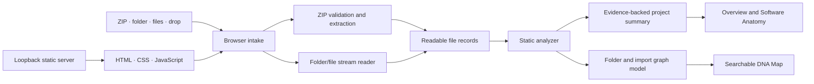

# Architecture and data flow

CODE DNA is a static browser application with a tiny loopback HTTP server. Project files are selected by the browser and analyzed in the tab; they are not sent to `server.mjs`.

## Modules

| Module | Responsibility |
| --- | --- |
| `server.mjs` | Serves repository files over HTTP on `127.0.0.1:4173`; it has no project-upload API. |
| `index.html` | Defines the Overview, Software Anatomy, and DNA Map views, upload controls, and status UI. |
| `app.js` | Connects browser file pickers and drag-and-drop to analysis, renders reports and graph interactions, and stores an optional bounded metadata snapshot in tab session storage. |
| `core/analyzer.mjs` | Validates and reads ZIP/folder inputs, applies limits and ignore rules, computes lexical metrics, extracts supported import/declaration evidence, and builds project summaries. |
| `core/graph.mjs` | Builds explicit folder/file containment nodes and adds only import edges supplied by the analyzer. |
| `styles.css`, `design.css` | Base layout, responsive behavior, and the visual system. |
| `test/analyzer.test.mjs` | Exercises ZIP safety, file ingestion, metrics, evidence extraction, graph construction, and cycle detection with Node's built-in test runner. |

## Data lifecycle

1. A file picker or drop event supplies browser `File` objects.
2. ZIP archives are checked for path traversal, encryption, ZIP64 markers, suspicious compression ratios, unsupported compression, and configured size limits before readable records are returned. Folder and individual-file inputs are filtered against generated directories and streamed when large.
3. The analyzer derives languages, approximate line counts, manifest-based package evidence, supported import references, and lightweight declaration matches.
4. The UI renders those records in the summary, anatomy report, inventory, and graph.
5. A bounded metadata-only snapshot can be stored in `sessionStorage` for refresh recovery. Raw file contents are excluded from that snapshot.

The browser still has to hold a selected ZIP archive before its central directory can be inspected. Folder selection is the better input for very large files. The analyzer never runs package scripts or project code.

## Evidence model and limits

- File/folder containment comes directly from relative paths.
- Import links come from supported static source patterns and successful relative-path resolution.
- Framework and tool detections use readable manifest/configuration evidence.
- Line and comment counts are lexical approximations; declaration matches are not AST parsing.
- Runtime behavior, dynamic imports, TypeScript path aliases, package export maps, full call/data flow, and broad multi-language dependency semantics are outside the current implementation.

See the README's [analysis boundaries](../README.md#how-the-analysis-works) and [feature status](./FEATURES.md).
